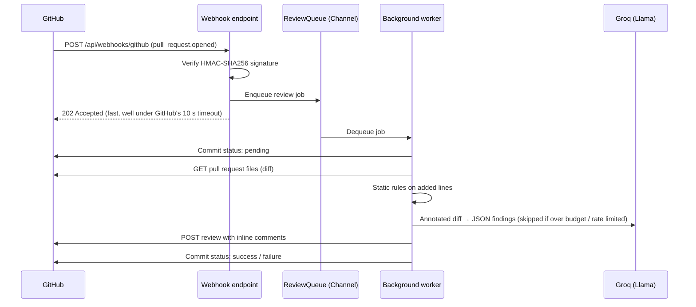

# 🚓 PullPatrol

**Automated pull request reviews for GitHub, built with .NET 10.**

PullPatrol listens for GitHub webhooks. When a pull request is opened or updated, it checks the changed code for security risks, bugs and performance problems, then comments directly on the PR. The analysis combines fast deterministic rules with an AI review by an open-source LLM (Llama 3.3 70B, served for free by [Groq](https://groq.com)). It also sets a commit status, so branch protection can block merges that have serious findings.


## How it works



1. **Webhook endpoint:** it verifies the `X-Hub-Signature-256` HMAC in constant time, ignores events that don't need a review (closed PRs, drafts, other event types), and puts the job on a bounded in-memory queue. It responds right away.
2. **Background worker:** a `BackgroundService` takes jobs from the queue one at a time and runs each one in its own DI scope. If one job fails, the worker keeps running.
3. **Analysis:**
   - **Static rules** (`StaticRuleAnalyzer`) run regex checks on the *added* lines only. They look for hardcoded secrets and tokens, private keys, SQL built with string concatenation, disabled TLS validation, weak hashes, `eval`/`innerHTML`, `.Result`/`.Wait()`, `async void`, empty catch blocks and `new HttpClient()`.
   - **AI review** (`GroqReviewer`) sends the diff to Llama through Groq's OpenAI-compatible API, with a new-file line number on every line. It asks for a JSON response and then validates each finding. Findings with missing fields, or that point to files that aren't in the PR, are dropped. The prompt treats the PR contents as untrusted input to protect against prompt injection.
   - **Built for the free tier:** before each request, PullPatrol estimates the prompt size and includes only the files that fit within `Groq:MaxInputTokens`. If Groq replies `429`/`413`, PullPatrol follows `Retry-After` and skips the AI until the limit resets. In both cases the review goes out as usual with the static rules only. The PR author just sees a normal review, whose footer says what analyzed it.
4. **Publishing:** findings on lines that are part of the diff become inline review comments. Everything else goes into the review summary. When a rule and the AI flag the same line, PullPatrol posts only one of them. If GitHub rejects the inline comments (for example after a force-push), PullPatrol posts the review again as a summary only.
5. **Commit status:** the `PullPatrol` status is `failure` when any finding is at or above `Review:FailOnSeverity` (default `High`). Mark it as required in branch protection to gate merges.

## Tech stack and design decisions

| Area | Choice |
|---|---|
| API | ASP.NET Core 10 Minimal APIs, OpenAPI document at `/openapi/v1.json` (Development) |
| Async processing | `System.Threading.Channels` + `BackgroundService` |
| GitHub integration | Typed `HttpClient` via `IHttpClientFactory`, with `Microsoft.Extensions.Http.Resilience` (retries, timeouts, circuit breaker; POSTs are never retried, to avoid posting the same review twice) |
| AI | Llama 3.3 70B via Groq's OpenAI-compatible API (typed `HttpClient`, JSON mode), token budget, and fallback to rules when rate limited |
| Secrets | Options pattern with validation on startup; user-secrets locally, environment variables in containers. Nothing secret is committed |
| Security | HMAC-SHA256 webhook verification, constant-time comparisons, admin endpoints disabled unless a key is configured |
| Testing | xUnit unit tests and integration tests with `WebApplicationFactory` (the full webhook → queue → worker → GitHub flow, with GitHub faked) |
| DevOps | GitHub Actions CI (build, test, Docker build), multi-stage Dockerfile running as a non-root user |

## Getting started

### Prerequisites

- .NET 10 SDK
- A GitHub [fine-grained personal access token](https://github.com/settings/personal-access-tokens) for the repositories you want reviewed, with these permissions:
  - **Pull requests:** Read and write
  - **Commit statuses:** Read and write
  - **Contents:** Read-only
- Optional: a free [Groq API key](https://console.groq.com/keys) for the AI review. Without one, only the static rules run.

### 1. Configure secrets

```bash
cd src/PullPatrol.Api
dotnet user-secrets set "GitHub:Token" "github_pat_..."
dotnet user-secrets set "GitHub:WebhookSecret" "$(openssl rand -hex 32)"
dotnet user-secrets set "Groq:ApiKey" "gsk_..."                 # optional, free
dotnet user-secrets set "Review:AdminApiKey" "$(openssl rand -hex 16)"  # optional, enables /api/reviews
```

### 2. Run

```bash
dotnet run --project src/PullPatrol.Api
```

### 3. Expose it to GitHub

GitHub has to be able to reach the webhook endpoint. For local development, use a tunnel such as [smee.io](https://smee.io) or `ngrok http 5242`.

### 4. Add the webhook

In your repository, open **Settings → Webhooks → Add webhook** and fill in:

- **Payload URL:** `https://<your-tunnel>/api/webhooks/github`
- **Content type:** `application/json`
- **Secret:** the same value as `GitHub:WebhookSecret`
- **Events:** *Let me select individual events* → **Pull requests**

Then open a pull request and wait for the review to appear.

### Run with Docker

```bash
docker build -t pullpatrol .
docker run -p 8080:8080 \
  -e GitHub__Token=github_pat_... \
  -e GitHub__WebhookSecret=... \
  -e Groq__ApiKey=gsk_... \
  pullpatrol
```

## API

| Method | Path | Description |
|---|---|---|
| `POST` | `/api/webhooks/github` | GitHub webhook receiver (signature required) |
| `GET` | `/api/reviews` | The 50 most recent reviews (`X-Api-Key` header required) |
| `POST` | `/api/reviews` | Start a review manually: `{ "owner": "...", "repo": "...", "number": 1 }` (`X-Api-Key` header required) |
| `GET` | `/health` | Health check |

## Configuration

| Key | Default | Description |
|---|---|---|
| `GitHub:Token` | *(required)* | GitHub token used to read diffs and post reviews |
| `GitHub:WebhookSecret` | *(required)* | Webhook secret used to verify deliveries |
| `Groq:ApiKey` | *(empty)* | Enables the AI review. Falls back to `GROQ_API_KEY` |
| `Groq:Model` | `llama-3.3-70b-versatile` | Any chat model on Groq (see [models](https://console.groq.com/docs/models)) |
| `Groq:MaxInputTokens` | `8000` | Estimated prompt-token budget per review. Keep input + output under your plan's tokens-per-minute limit |
| `Groq:MaxOutputTokens` | `2000` | Maximum length of the model's answer |
| `Review:MaxInlineComments` | `25` | Maximum number of inline comments. The rest go into the summary |
| `Review:FailOnSeverity` | `High` | Lowest severity that sets the commit status to `failure` |
| `Review:IgnoredPaths` | lock files, minified, generated, migrations | Paths that are never analyzed |
| `Review:AdminApiKey` | *(empty)* | Enables the `/api/reviews` endpoints |

## Testing

```bash
dotnet test
```

## Roadmap

- [ ] Run as a **GitHub App** (installation tokens, one-click install) instead of a personal access token
- [ ] Persistent job queue and review history (e.g. PostgreSQL / Azure Service Bus) so jobs survive a restart
- [ ] Cancel a stale review when a new commit is pushed to the same PR
- [ ] Per-repository configuration via a `.pullpatrol.yml` file
- [ ] Dashboard (Blazor or React) showing review history and statistics
- [ ] Deploy to Azure Container Apps with GitHub Actions
